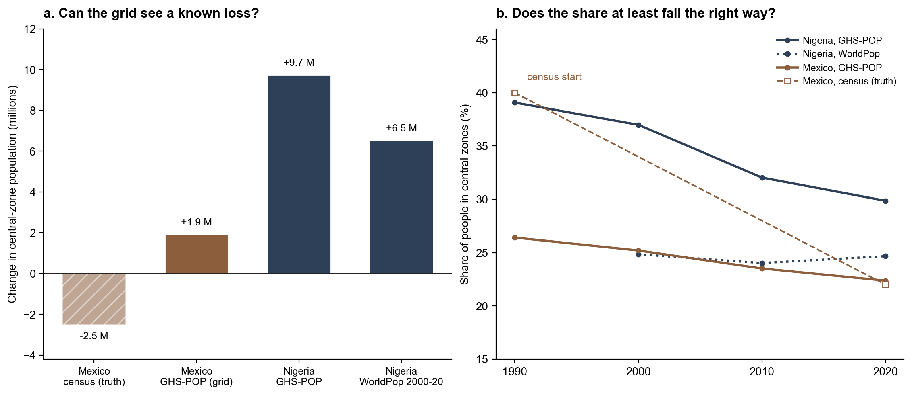
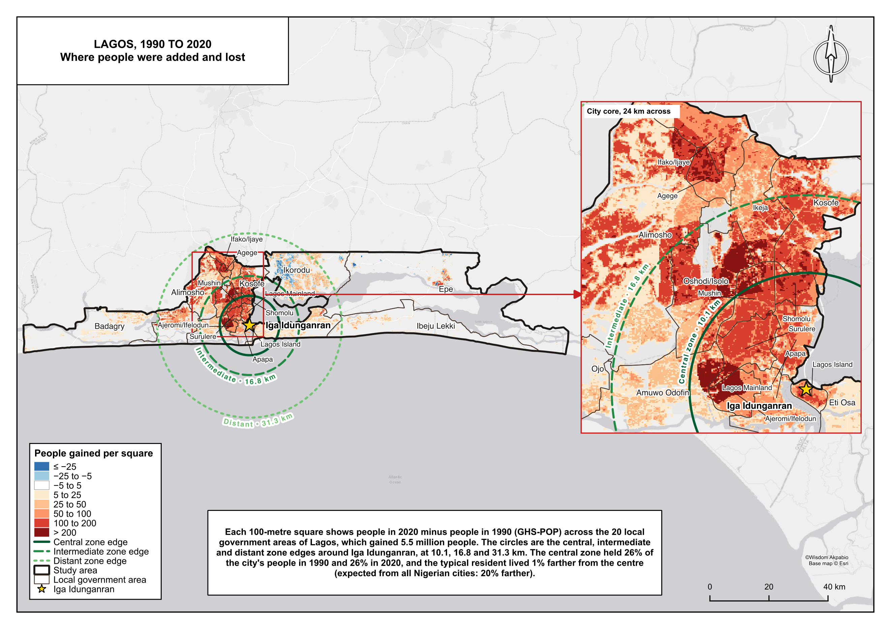
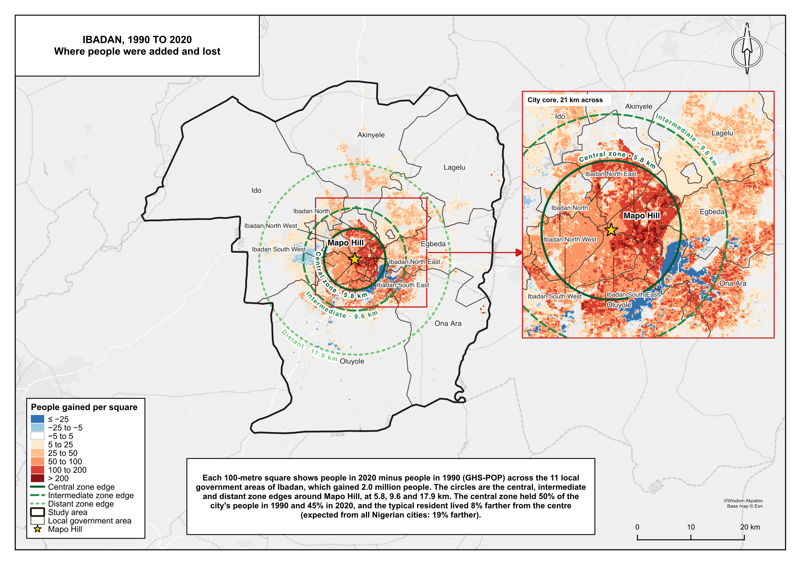
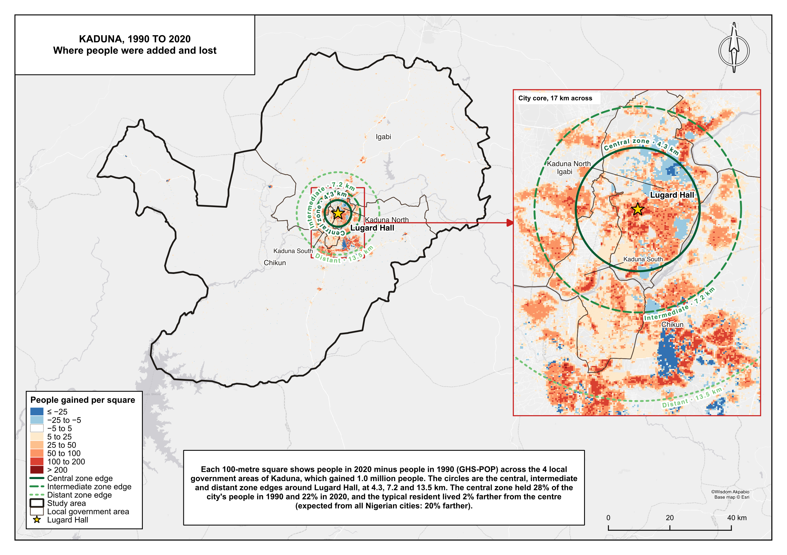
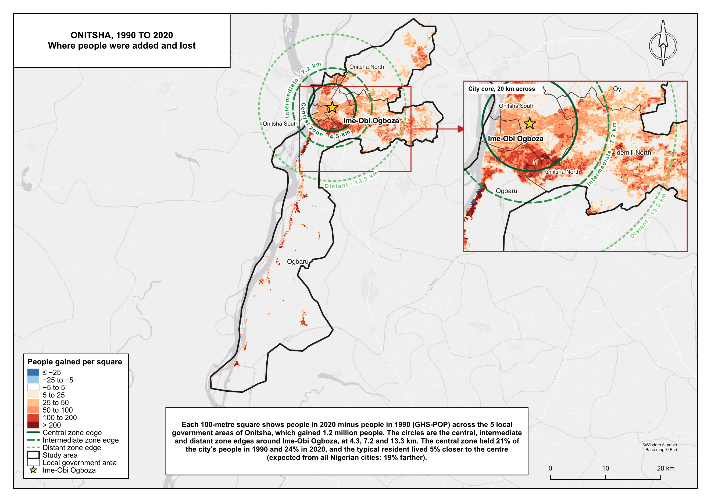
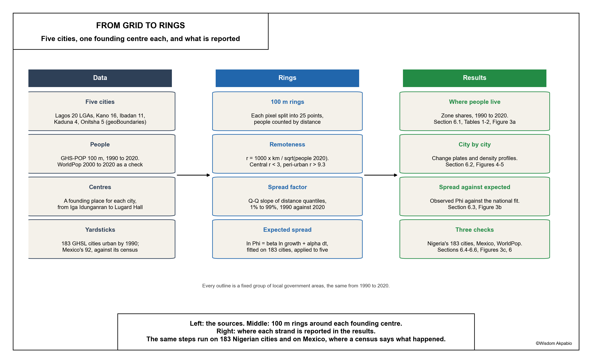

# Where the centre holds

**Map:** [whizialfa.github.io/nigeria-urban-spread](https://whizialfa.github.io/nigeria-urban-spread/)

**People and distance in Nigeria's five largest cities, 1990 to 2020**

Adaptation of Peraza-Mues, Resendiz, Figueroa-Soriano, Prieto-Curiel and Ponce-Lopez (2025), [Scaling and population loss in Mexican urban centres](https://arxiv.org/abs/2509.16110). The anchor counts Mexico's census block by block in 69 cities. Nigeria has no census since 2006, so this runs the same rings, zones and spread factor on its five largest cities (Lagos, Kano, Ibadan, Kaduna and Onitsha, each drawn as its local government areas) with people from the GHS-POP grid. Each city is read against 183 older Nigerian cities on the same grid, checked against WorldPop, and the grid itself is tested on Mexico, where the census answer is known.

Write-up: [`notes/results.md`](notes/results.md) and the PDF [`notes/where_the_centre_holds.pdf`](notes/where_the_centre_holds.pdf). Two-page brief: [`notes/where_the_centre_holds_brief.pdf`](notes/where_the_centre_holds_brief.pdf). Trace from raw input to every quoted number: [`notes/metric_trace.md`](notes/metric_trace.md). Live scrolly map: [`web/`](web/) on GitHub Pages.

## Findings

**The largest cities kept their centres.** Together the five grew from 12.3 to 25.4 million people. Their central zones took 32% of that growth, and the central share slipped only from 35.8% to 33.9%. Across 183 older Nigerian cities on the same grid it fell from 39.1% to 29.9%.

**They spread far less than expected.** For a city that doubled, the national fit expects the typical resident to end about 19% farther from the centre. Ibadan reached 8%, Kano 5%, Kaduna 2%, Lagos 1%, and Onitsha's people ended 5% closer.

**The counts at the centre are not trusted.** GHS-POP puts 4.2 million more people in the five central zones. Run on Mexico, the same grid turns the census loss of 2.5 million into a gain of 1.9 million, though it gets the direction of the share right. WorldPop disagrees with GHS-POP in Kaduna and Onitsha. The share and the comparison between cities are the result; the count needs a census.

| City | LGAs | People 1990 | People 2020 | Central zone reaches | Central share | φ (expected) |
|---|---|---|---|---|---|---|
| Lagos | 20 | 5.82 M | 11.31 M | 10.1 km | 25.8% to 25.6% | 1.01 (1.20) |
| Kano | 16 | 2.88 M | 6.22 M | 7.5 km | 55.3% to 49.6% | 1.05 (1.19) |
| Ibadan | 11 | 1.68 M | 3.69 M | 5.8 km | 49.5% to 45.0% | 1.08 (1.19) |
| Kaduna | 4 | 1.08 M | 2.09 M | 4.3 km | 27.6% to 22.4% | 1.02 (1.20) |
| Onitsha | 5 | 0.89 M | 2.05 M | 4.3 km | 21.4% to 23.9% | 0.95 (1.19) |

| | |
|---|---|
|  |  |
|  |  |
|  |  |
|  |  |

## Frame

- **Cities:** fixed groups of LGAs from geoBoundaries. Lagos, all 20 in Lagos State; Kano, the 8 metropolitan LGAs and the 8 around them; Ibadan, all 11 metropolitan; Kaduna, North, South, Chikun and Igabi; Onitsha, the 5 of UN-Habitat's Greater Onitsha. Ranked by people in 2020; Port Harcourt is sixth.
- **People:** GHS-POP R2023A at 100 m, 1990 to 2020. WorldPop 2000 to 2020 as the second grid.
- **Centre:** the founding place: Iga Idunganran, Gidan Rumfa, Mapo Hill, Lugard Hall, Ime-Obi Ogboza.
- **Rings:** 100 m wide, distance measured on the ground in a per-city equidistant projection.
- **Zones:** remoteness r = 1000 · distance (km) / √(2020 population). Central under 3, intermediate 3 to 5, distant 5 to 9.3, peri-urban beyond.
- **Yardsticks:** 183 GHSL urban centres in Nigeria urban by 1990, inside their own outlines; 92 in Mexico.

## Run

```bash
cd src
python download_ghsl.py              # GHSL and WorldPop for Nigeria's GHSL centres, through Earth Engine
python download_ghsl.py mx           # GHSL for Mexico
python lga_cities.py                 # the five LGA outlines (rank: every candidate city)
python download_ghsl.py lga          # grids for the five LGA outlines
python radial.py ghs                 # people per ring; also: worldpop, mx, lga, lga_worldpop
python analyse.py ghs                # national yardstick; also: ghs2000, worldpop, mx
python analyse.py lga                # the five cities; also: lga_ghs2000, lga_worldpop
python charts.py tests city_profiles city_results
python flowchart.py
python plate_data.py top5            # study-area plate layers; results: change plates
python plate_data.py results
cd ..
env -u PYTHONPATH /Applications/QGIS.app/Contents/MacOS/bin/python3.9 qgis/build_plates.py study_lagos results_lagos
```

Then the PDFs, from `notes/`:

```bash
pandoc results.md -o results.html --standalone --template=template.html
pandoc brief.md -o brief.html --standalone --template=brief-template.html
"/Applications/Google Chrome.app/Contents/MacOS/Google Chrome" --headless=new --no-pdf-header-footer \
  --allow-file-access-from-files --print-to-pdf="$PWD/where_the_centre_holds.pdf" "file://$PWD/results.html"
"/Applications/Google Chrome.app/Contents/MacOS/Google Chrome" --headless=new --no-pdf-header-footer \
  --allow-file-access-from-files --print-to-pdf="$PWD/where_the_centre_holds_brief.pdf" "file://$PWD/brief.html"
```

`qgis/urban_spread_method.py` is a QGIS Processing script of the full method (rings, remoteness zones, shares, φ) for one city: Add Script to Toolbox → Wisdom maps → Urban spread method. `qgis/study_area_plate.py` builds the study-area plate for any named place.

Rasters and geopackages land in `data/` and are not committed; quoted tables are in `data/processed/*.csv`.
