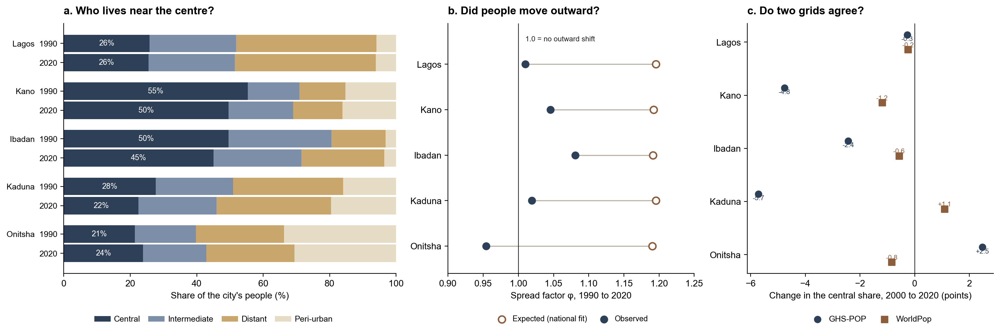
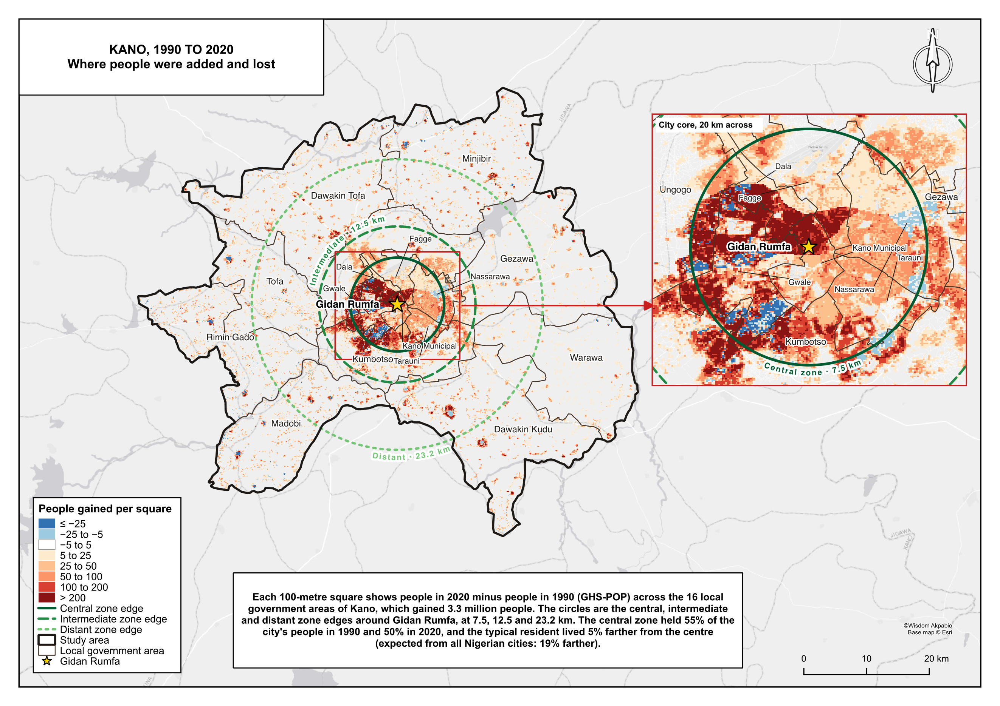

Between 1990 and 2020 the centres of Mexico's cities lost 2.5 million residents while their edges filled. This brief asks what happened at the centre of Nigeria's five largest cities: Lagos, Kano, Ibadan, Kaduna and Onitsha. Each city is drawn as the local government areas that make it up and measured from its founding place, from Iga Idunganran on Lagos Island to Lugard Hall in Kaduna. Rings 100 metres wide split each city into four zones scaled to its size: central, intermediate, distant and peri-urban. People come from GHS-POP, a satellite-based population grid at 100 metres.

# The largest cities kept their centres

Together the five cities grew from 12.3 to 25.4 million people. Their central zones took 32% of that growth, and their central share slipped only from 35.8% to 33.9%. Kano, Ibadan and Kaduna each lost about five points. Lagos held almost exactly. Onitsha's centre gained share. Across 183 older Nigerian cities on the same grid, the central share fell by more than nine points, and by thirteen in the median town. The towns spread; the big cities filled in.

<figure class="brief-chart brief-big">

<figcaption>Left, where each city's people lived in 1990 and 2020. Middle, how far the typical resident moved outward (filled) against what the rest of urban Nigeria predicts for a city of the same growth (open). Right, the change in central share on two grids, 2000 to 2020.</figcaption>
</figure>

# They spread far less than expected

A typical older Nigerian city that doubled between 1990 and 2020 ended with its typical resident about 19% farther from the centre. Ibadan reached 8%, Kano 5%, Kaduna 2% and Lagos 1%. Onitsha's people ended 5% closer. Even Kaduna, a planned colonial city whose growth went to Rigasa and to Narayi and Sabon Tasha on its edges, fell far short of the expected spread. Both sides of this comparison use the same grid and the same steps, so it is the most reliable finding here.

# Why the counts are not trusted

The grid says the five central zones gained 4.2 million people. That is not evidence that the old cores filled up. Run through the same steps, the same grid turns Mexico's census loss of 2.5 million into a gain of 1.9 million. It gets the direction of the share right in Mexico but understates the fall, so the real falls in Kano, Ibadan and Kaduna are probably larger. A second grid, WorldPop, barely changes shape from year to year and disagrees with GHS-POP in Kaduna and Onitsha.

<figure class="brief-plate brief-fill">

<figcaption>Kano, 1990 to 2020. Red squares gained people, blue squares lost them. The green circles are the central, intermediate and distant zone edges around Gidan Rumfa, the Emir's palace. Nearly half of Kano's added people went within 7.5 km of it.</figcaption>
</figure>

# What this means

Most of the growth in Lagos went to the mainland belt through Ajeromi/Ifelodun, Mushin, Oshodi/Isolo and Agege, not to Lekki or Ikorodu. Kano's went into and around the walled city. Kaduna's went to Rigasa, Narayi and Sabon Tasha, and Ibadan's along the roads to Akinyele, Egbeda and Ido. Water, drainage and schools follow those places. Whether the old centres themselves emptied needs a census count by enumeration area in Lagos Island, Kano Municipal, Ibadan North, Kaduna North and Onitsha North and South. Nigeria's last census was in 2006.

# What this does not show

These are modelled people, spread from satellite-mapped buildings, inside LGA outlines held fixed from 1990 to 2020. Lagos stops at the Ogun State line, Kaduna's outline is mostly farmland, and Onitsha's leaves out Asaba across the Niger. The paper's count of people at the centre rests on a grid that failed the Mexican test, so it is not leaned on.
